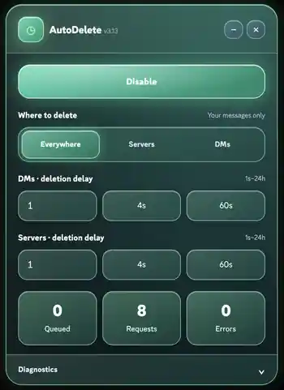

# Discord AutoDelete — Self-Destructing Messages in Discord Web

**Give your next Discord messages an expiration timer.** AutoDelete is an experimental, single-file JavaScript tool that watches for **your newly sent messages** and automatically **attempts to delete them** after a delay you choose — as short as **1 second**.

**No manual token entry. No token extraction. No separate application. No bulk-history cleanup.** Just an in-page dashboard for timed deletion of your own new DMs and server messages.

[](https://github.com/R1universe/discord-console-autodelete/actions/workflows/test.yml)
[](./autodelete.js)
[](#important-limitations-and-discord-policy)

<p align="center">
  
</p>

<p align="center"><sub>Actual AutoDelete v3.13 interface · enabled state</sub></p>

> [!WARNING]
> **Experimental, unofficial Discord self-bot automation.** Discord prohibits automating regular user accounts; using this script can result in account restrictions or termination. The tool does **not guarantee** that a message will disappear at the requested time, or that it was not read, copied, saved or logged beforehand. Not affiliated with Discord.

## The idea: self-destructing-style messages for Discord

Send a message. The script detects it. A countdown begins. When its timer expires, AutoDelete asks the Discord client to delete that message.

```text
You send a new DM  →  Detected  →  4-second timer  →  Delete attempted
You send in a server → Detected  →  60-second timer →  Delete attempted
```

This is **not a bulk message deleter**. It is designed to give **future messages a configurable lifetime**, while the script is enabled in your Discord Web tab.

### What makes AutoDelete different?

| Most Discord history-cleanup tools | Discord AutoDelete |
| --- | --- |
| Search for **old** messages and delete them in a batch | Watch for **new** messages and schedule each one separately |
| A cleanup session that you start when you want to erase history | An enabled monitor that reacts as you send |
| “Delete delay” often means *time between API requests* | “Deletion delay” means *how long a newly detected message waits before deletion is attempted* |
| May ask for or extract an account token to make API requests | Does **not explicitly extract a token** or ask you to paste one; calls existing authenticated Discord client functions |

This is a **distinct approach**, not a claim to be the world's first Discord deletion script. Existing projects such as [Undiscord](https://github.com/victornpb/undiscord) focus on cleaning existing message history instead.

## Features

- **Live self-destruct timer:** automatically queue an attempted deletion for each detected, newly sent message by your account.
- **Separate DM and server delays:** any whole number from **1 to 86,400 seconds (24 hours)**, with **4s / 60s** quick presets.
- **Choose where:** **Everywhere / Servers / DMs** (including group DMs when channel classification is available).
- **In-Discord glass dashboard:** floating and draggable UI, color-coded disabled/enabled states, timer controls and collapsible diagnostics.
- **No manual token entry or token scraping:** uses Discord's internal authenticated `RestAPI.del()` or `MessageActions.deleteMessage()` when discoverable.
- **Queue monitoring:** see pending timers, deletion requests initiated and errors caught. These are **not** a verified count of successful deletions.
- **Hide without stopping:** the `−` button removes the panel from view while enabled monitoring continues. Restore with `DiscordAutoDelete.open()`.
- **Local preferences:** delays and selected scope are remembered in the browser; **the script starts disabled on every fresh load**.

## Quick start — Discord Web console

1. **Review the complete [`autodelete.js`](./autodelete.js) source first.** Never execute untrusted code in an authenticated browser console.
2. Open [Discord Web](https://discord.com/app). Open the developer console: **Chrome on macOS** `Cmd + Option + J`; **Chrome on Windows/Linux** `Ctrl + Shift + J`.
3. Copy the reviewed `autodelete.js` source into the console and run it. No npm, Python, userscript extension or separate desktop application is required.
4. In the AutoDelete dashboard, select **Everywhere / Servers / DMs**, set your message lifetime, and press **Enable**.
5. Send a harmless new message in a test conversation and observe the queue and diagnostics. Use **Disable** to stop monitoring and cancel pending timers.

**Never share your Discord token, cookies or authorization headers.** Do not run unreviewed remote loaders such as `fetch(...).then(eval)`.

### Console controls

```js
DiscordAutoDelete.status()            // Status and diagnostics summary
DiscordAutoDelete.setDmDelay(4)        // DM timer: 4 seconds
DiscordAutoDelete.setServerDelay(60)   // Server timer: 60 seconds
DiscordAutoDelete.setScope("all")      // "all", "servers", or "dm"
DiscordAutoDelete.open()               // Reopen hidden dashboard
DiscordAutoDelete.hide()               // Hide without pausing
DiscordAutoDelete.openDiagnostics()    // Show diagnostic log
DiscordAutoDelete.pause()              // Disable and cancel queued timers
DiscordAutoDelete.stop()               // Remove script UI and stop
```

## How it works — technical architecture

1. **Find client modules.** Inspect Discord Web's existing Webpack module cache for `UserStore`, a usable `FluxDispatcher`, message stores and the client's deletion methods. The script does not obtain a raw user token.
2. **Listen for your next messages.** Subscribe to `MESSAGE_CREATE` events when available. If event subscription is unavailable but the relevant stores exist, fall back to polling the **currently selected channel's** message cache.
3. **Only queue eligible new messages.** Check the author against the logged-in user, reject provisional/unconfirmed IDs, avoid repeated events, and apply the chosen DM/server scope.
4. **Start a per-message timer.** Use `setTimeout()` with the selected delay. The clock begins when a confirmed message is **observed** — not necessarily exactly when you press Send.
5. **Request deletion.** Call Discord's existing authenticated internal deletion action. The browser client and Discord servers ultimately determine whether the request succeeds.

**Why not the same as Undiscord?** Undiscord searches historical messages and sends its own authenticated API deletion requests, commonly using an automatically retrieved token. AutoDelete instead observes **new messages** and invokes existing client deletion methods **without explicit token extraction**.

## What the dashboard actually counts

| Counter | Meaning |
| --- | --- |
| **Queued** | Message-deletion timers still pending |
| **Requests** | Deletion function calls **attempted — not server-confirmed successful deletions** |
| **Errors** | Errors the script catches; background failures may be missing |

### Important limitations and Discord policy

- **Not instant, guaranteed or truly ephemeral.** A 1-second setting is a target delay after detection, not a guarantee that Discord will remove the message in one second. Other participants can preserve messages before deletion.
- **Not a message-history cleaner.** The script does not automatically erase messages sent before you enable it.
- **Unofficial and fragile.** Discord can change undocumented Webpack exports, event handling or deletion methods at any time.
- **Limited fallback coverage.** Cache-only monitoring observes the currently open channel, **not every server and DM globally**.
- **Browser-tab lifecycle.** Refreshing the page stops the script and loses its pending timers. **Disable** also cancels timers; **minimizing the UI does not**.
- **Not a privacy or security guarantee.** This does not provide end-to-end disappearing-message protection.
- **Discord's [self-bot policy](https://support.discord.com/hc/en-us/articles/115002192352-Automated-User-Accounts-Self-Bots)** prohibits automating normal user accounts. Account sanctions are possible. An officially supported alternative for permitted use cases is the [Discord bot API](https://discord.com/developers/docs/intro).

## Project status

**v3.13 · Experimental JavaScript browser-console prototype.** Automated checks cover mocked Discord client scenarios; **they do not certify compatibility or successful deletion on live Discord**.

- [Source code](./autodelete.js)
- [Manual QA test plan](./QA_TEST_PLAN.md)
- [Automated tests](./test/test.js)
- [Known issues and bug reports](https://github.com/R1universe/discord-console-autodelete/issues)
- [Release history and technical investigations](./docs/RELEASE_HISTORY.md)
- [GitHub Topics and discovery settings](./docs/REPOSITORY_DISCOVERY.md)

If you find this **self-destructing-style Discord message timer** useful, consider starring the repository. For bug reports, include reproducible steps but **never** tokens, real message contents or private identifiers.
